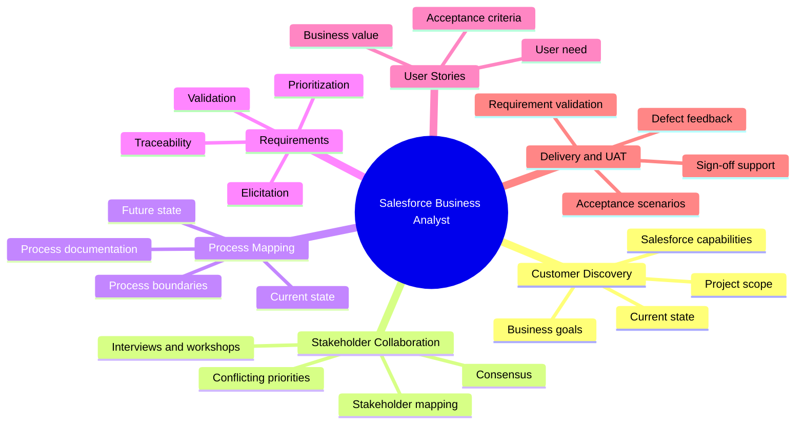
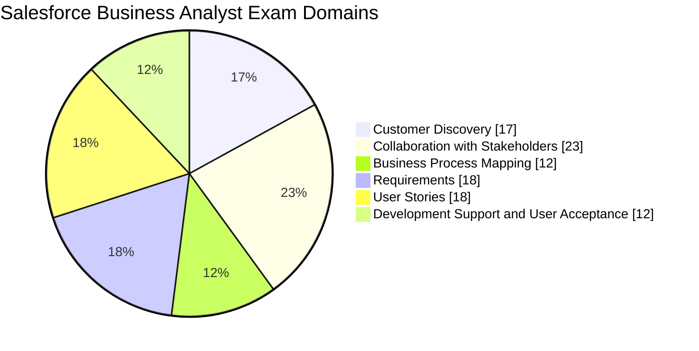
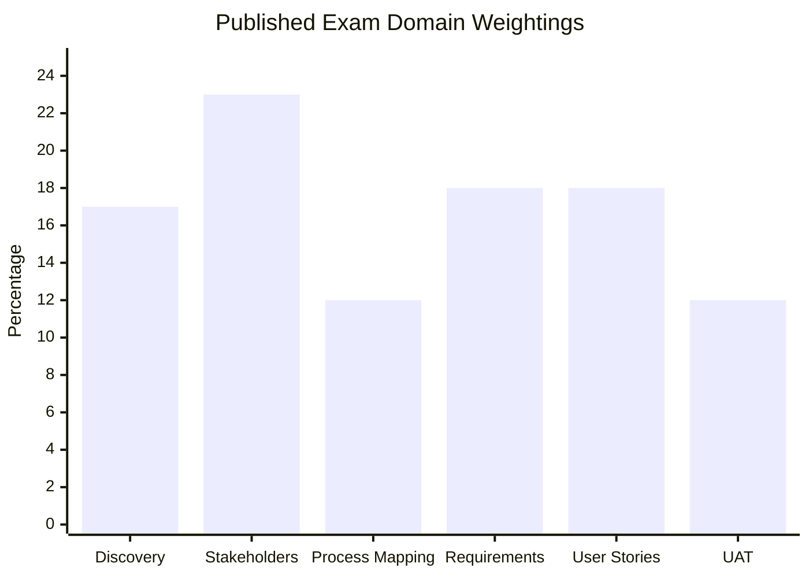
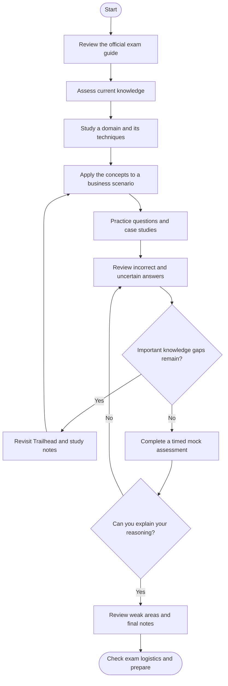
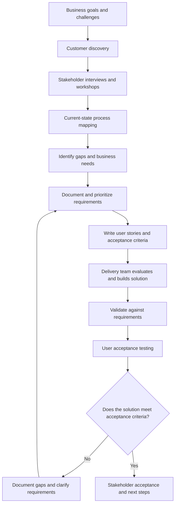
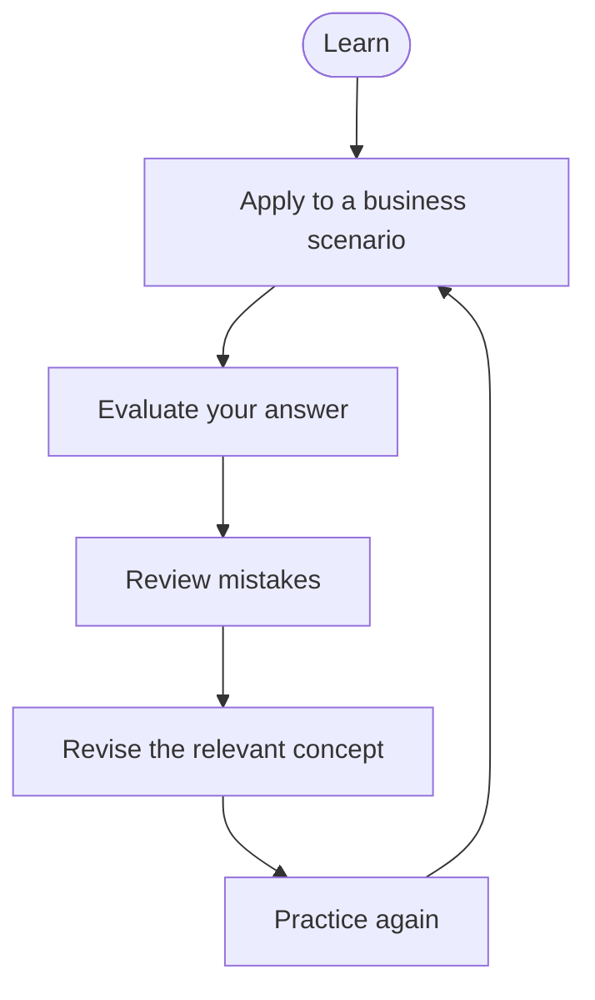
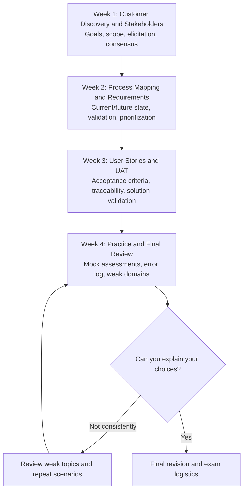

# Salesforce Certified Business Analyst Study Guide

A practical study guide for the Salesforce Certified Business Analyst certification, focused on understanding business needs, collaborating with stakeholders, mapping processes, documenting requirements, writing user stories, and validating Salesforce solutions.

This repository combines official Salesforce learning resources with independent study recommendations, scenario-based examples, revision diagrams, and original practice questions.

> **Start with the official exam guide:** [Salesforce Certified Business Analyst Exam Guide](https://help.salesforce.com/s/articleView?id=005298939&language=en_US&type=1)

> **Supplementary preparation:** [CertsGate Salesforce Certified Business Analyst resources](https://certsgate.com/exams/salesforce/certified-business-analyst)

---

## Table of Contents

- [Overview](#overview)
- [About the Certification](#about-the-certification)
- [Who Should Prepare?](#who-should-prepare)
- [Skills and Knowledge Areas](#skills-and-knowledge-areas)
- [Official Exam Objectives and Weightings](#official-exam-objectives-and-weightings)
- [Exam Preparation Flowchart](#exam-preparation-flowchart)
- [Business Analysis Workflow](#business-analysis-workflow)
- [Study and Revision Cycle](#study-and-revision-cycle)
- [Step-by-Step Preparation Guide](#step-by-step-preparation-guide)
- [Four-Week Study Roadmap](#four-week-study-roadmap)
- [Practice Questions](#practice-questions)
- [Hands-On Projects](#hands-on-projects)
- [Common Preparation Mistakes](#common-preparation-mistakes)
- [Certification Benefits and Career Relevance](#certification-benefits-and-career-relevance)
- [Frequently Asked Questions](#frequently-asked-questions)
- [Official and Additional Learning Resources](#official-and-additional-learning-resources)
- [About CertsGate](#about-certsgate)

---

## Overview

A Salesforce Business Analyst helps translate business needs into requirements that a Salesforce team can understand, evaluate, and implement. The role involves asking the right questions, documenting current processes, identifying gaps, facilitating stakeholder discussions, and confirming that the delivered solution addresses the agreed requirements.

The Salesforce Certified Business Analyst exam assesses these skills through topics such as customer discovery, stakeholder collaboration, business process mapping, requirements, user stories, and user acceptance testing.

Preparing effectively means more than memorizing terminology. You need to recognize which analysis technique fits a scenario, distinguish business needs from proposed solutions, and explain how requirements can be validated before a solution is accepted.

This Salesforce Business Analyst study guide provides a structured way to prepare, practice, and identify areas that need more attention.

## About the Certification

The **Salesforce Certified Business Analyst** credential is designed for professionals who understand business needs, capture requirements, and collaborate with stakeholders to support Salesforce solutions that improve business processes.

Salesforce's official exam guide describes an intended audience with experience in business analysis and the Salesforce Platform. It recommends combining practical experience with self-study.

### Exam information

| Detail | Published information |
|---|---|
| Official credential | Salesforce Certified Business Analyst |
| Certification provider | Salesforce |
| Intended audience | Business analysts and professionals involved in Salesforce business improvements |
| Recommended experience | The official guide describes two years of business analyst experience and two years of Salesforce Platform experience |
| Prerequisite | None listed in the official guide |
| Question format | 60 multiple-choice questions, plus up to five unscored questions |
| Time limit | 105 minutes |
| Published passing score | 72% |
| Delivery | Proctored testing center or online, subject to current availability |
| Official preparation | Salesforce Business Analyst Certification Prep on Trailhead |

**Version caution:** The official exam guide currently displays an older Winter ’25 release alignment. The domain information below follows the published outline, but candidates should verify the current exam version, logistics, and policies before booking.

Sources: [Official exam guide](https://help.salesforce.com/s/articleView?id=005298939&language=en_US&type=1) and [Trailhead certification preparation module](https://trailhead.salesforce.com/content/learn/modules/salesforce-business-analyst-certification-prep/get-started-with-salesforce-business-analyst-certification-prep).

## Who Should Prepare?

This certification may be relevant to:

- Business analysts working with Salesforce projects.
- Salesforce consultants who gather and document business requirements.
- Business systems analysts connecting business teams with technical teams.
- Salesforce administrators expanding their business analysis skills.
- Product owners who work with stakeholders and delivery teams.
- CRM and business process specialists.
- Professionals involved in requirements validation and user acceptance testing.

Candidates should be comfortable discussing business processes, communicating with different stakeholders, and organizing information into clear requirements. Familiarity with Salesforce terminology and the implementation lifecycle is also helpful.

The credential focuses on business analysis and solution evaluation. It is not primarily a programming exam, and candidates should not assume that writing custom code or designing detailed technical architecture is its central objective.

## Skills and Knowledge Areas

The exam focuses on six areas of business analysis.

| Skill area | What to understand |
|---|---|
| Customer Discovery | Business goals, existing processes, project scope, current-state analysis, and identifying Salesforce opportunities |
| Collaboration with Stakeholders | Stakeholder identification, discovery planning, elicitation techniques, conflicting priorities, and consensus building |
| Business Process Mapping | Defining process boundaries, documenting steps, analyzing current and future states, and managing process documentation |
| Requirements | Distinguishing needs from scope and proposed solutions, gathering requirements, validation, prioritization, and version control |
| User Stories | Writing useful user stories, defining acceptance criteria, and maintaining traceability |
| Development Support and User Acceptance | Supporting delivery, validating requirements, preparing acceptance scenarios, and evaluating whether the solution meets agreed needs |

### Business analysis concept map

The following is an independent study map, not an official exam-weighting diagram.

## Official Exam Objectives and Weightings

The following percentages are published in Salesforce's Business Analyst exam guide and are also listed in the official Trailhead certification-preparation module.

| Official exam domain | Weight |
|---|---:|
| Customer Discovery | 17% |
| Collaboration with Stakeholders | 23% |
| Business Process Mapping | 12% |
| Requirements | 18% |
| User Stories | 18% |
| Development Support and User Acceptance | 12% |
| **Total** | **100%** |

### Exam domain weightage: pie chart

### Exam domain weightage: bar chart

**How to use the weighting:** Collaboration with Stakeholders is the largest published domain, at 23%. Give stakeholder discovery, elicitation techniques, competing priorities, and consensus-building scenarios substantial attention. Requirements and User Stories each represent 18%, so practice turning business needs into clear, testable statements.

Do not ignore the other domains. Process mapping and user acceptance can involve practical judgment that is difficult to develop through memorization alone.

**Official references:**
- [Salesforce Certified Business Analyst Exam Guide](https://help.salesforce.com/s/articleView?id=005298939&language=en_US&type=1)
- [Salesforce Business Analyst Certification Prep](https://trailhead.salesforce.com/content/learn/modules/salesforce-business-analyst-certification-prep/get-started-with-salesforce-business-analyst-certification-prep)

## Exam Preparation Flowchart

Use this process to move from reading the exam objectives to applying business analysis techniques in realistic scenarios.

A useful preparation habit is to connect every practice mistake to a specific exam objective. For example, if a question about conflicting stakeholder priorities causes difficulty, revisit the collaboration domain rather than rereading the entire guide.

## Business Analysis Workflow

Business analysis connects what a business wants to achieve with the solution a delivery team must validate. The diagram below shows a conceptual workflow for a Salesforce implementation. It is an educational model, not a claim that every project follows one mandatory sequence.

### A practical example

Imagine a company wants to reduce the time it takes to process customer service requests.

A Business Analyst should not immediately assume that a new automation is the answer. First, investigate the current workflow, speak with the people involved, identify delays, and clarify what success means to the business.

The analysis might reveal that requests are missing required information, responsibilities are unclear, or the approval process is unnecessarily complicated. Those findings shape the requirements and help the team evaluate suitable Salesforce capabilities.

This approach keeps the focus on the business problem rather than prematurely committing to a feature.

## Study and Revision Cycle

Business analysis preparation improves through repetition. Learn a technique, apply it to a scenario, evaluate your work, and revisit weak concepts before trying again.

Maintain an error log with four fields:

- **Topic:** Which exam objective was involved?
- **Mistake:** What did you misunderstand or overlook?
- **Correct reasoning:** Why is the better answer appropriate?
- **Next action:** What should you read, discuss, or practice again?

Revisit the log after a delay. If you can explain the answer without looking at your notes, you are more likely to understand the concept rather than simply remember it.

## Step-by-Step Preparation Guide

### 1. Start with customer discovery

Practice identifying business goals, challenges, existing systems, and the boundaries of a project.

A stakeholder may ask for a new Salesforce feature, but the underlying need could be faster processing, fewer errors, better visibility, or clearer accountability. Learn to ask follow-up questions before treating the requested feature as the final requirement.

Study how discovery activities are planned, how the current environment is assessed, and how Salesforce capabilities can be evaluated against business needs.

### 2. Improve stakeholder collaboration

Stakeholders can have different responsibilities, priorities, and definitions of success. A Business Analyst needs to understand those differences and choose appropriate ways to gather information.

Practice deciding when an interview, workshop, observation session, or other elicitation technique is suitable. Learn to identify key stakeholders, handle competing priorities, and guide discussions toward an agreed future state.

For each scenario, ask:

1. Who has relevant information or decision-making responsibility?
2. What needs to be learned from them?
3. Which discovery method best fits the situation?
4. How will disagreements or competing priorities be addressed?
5. How will the resulting decision be documented?

### 3. Map business processes

Learn to define the scope of a process and break a complicated workflow into understandable steps.

Practice documenting a current-state process before proposing a future state. Include relevant participants, decisions, handoffs, and points where delays or errors occur.

Use a simple example such as customer onboarding or service-request handling. Map the current workflow, identify gaps, and then describe a proposed workflow that addresses the documented business needs.

Keep process documentation organized and version controlled so that the team can understand changes and avoid working from conflicting versions.

### 4. Elicit and manage requirements

A business need, a requirement, and a proposed solution are related but different.

- **Business need:** The outcome or problem that matters to the organization.
- **Requirement:** A statement of what the solution must support or achieve.
- **Proposed solution:** A possible way to satisfy the requirement.

Practice gathering, clarifying, validating, and prioritizing requirements with stakeholders. Learn to identify ambiguity, missing information, conflicting expectations, and requirements that cannot be tested as written.

Maintain traceability between the business need, the documented requirement, the relevant user story, and the acceptance criteria where appropriate.

### 5. Write clear user stories

A user story communicates who needs something, what they need, and why it matters. A commonly used format is:

> As a [type of user], I want [capability], so that [business value].

For example:

> As a service representative, I want to see the status of each customer request so that I can provide accurate updates without searching through multiple records.

The story is a starting point, not a complete specification. Add acceptance criteria that describe observable outcomes and clarify how the team will determine whether the story has been satisfied.

Avoid vague criteria such as “the page should be user-friendly.” Prefer conditions that can be evaluated consistently.

### 6. Support development and user acceptance testing

The Business Analyst helps the team confirm that the delivered solution addresses the agreed requirements. This includes clarifying expected behavior, answering questions about business rules, and supporting validation activities.

For each requirement, consider:

- What result should the user see?
- What conditions must be satisfied?
- What alternative or error cases need testing?
- What evidence demonstrates that the requirement is met?
- How should a gap be recorded and clarified?

User acceptance testing (UAT) evaluates whether the solution supports the business process as intended. It is different from simply checking whether a feature technically works.

### 7. Practice scenario-based questions

After studying a domain, answer questions that require you to choose a suitable action in context. Explain why your answer is appropriate and why the alternatives are less suitable.

Use [CertsGate's Business Analyst preparation resource](https://certsgate.com/exams/salesforce/certified-business-analyst) as an independent supplementary option for reviewing study material and practice questions. Continue to rely on Salesforce's official documentation for the authoritative exam outline and product guidance.

## Four-Week Study Roadmap

This is a suggested schedule, not an official Salesforce requirement. Adjust it based on your experience, available time, and results from practice assessments.

| Week | Main focus | Suggested practice |
|---|---|---|
| 1 | Customer Discovery and Collaboration with Stakeholders | Create a stakeholder map and plan a discovery workshop |
| 2 | Business Process Mapping and Requirements | Map a current process and document prioritized requirements |
| 3 | User Stories and Development Support/UAT | Write user stories, acceptance criteria, and UAT scenarios |
| 4 | Practice and revision | Take mock assessments, analyze mistakes, and revisit weak objectives |

If you already work as a Business Analyst, focus more time on unfamiliar Salesforce-specific topics and the exam's terminology. If you are new to business analysis, spend additional time learning discovery, elicitation, process mapping, and requirements documentation.

## Practice Questions

The following are original educational examples created for this repository. They are **not official Salesforce exam questions** and are not represented as questions from a live exam.

### Question 1: Customer discovery

A stakeholder asks the team to automate a manual approval process. Before recommending a solution, what should the Business Analyst do first?

A. Select an automation tool immediately  
B. Understand the business goal, current process, and constraints  
C. Write acceptance criteria without further discussion  
D. Ask the delivery team to implement the request as stated  

**Answer: B**

**Explanation:** Discovery helps establish the business need and current state before a solution is selected. The requested automation may be appropriate, but the analyst should first understand the problem and what the business needs to improve.

### Question 2: Stakeholder collaboration

Two stakeholder groups disagree about which process improvement should be prioritized. What is an appropriate next step?

A. Choose the preference of the most vocal participant  
B. Ignore one group and proceed  
C. Clarify goals, constraints, and priorities, then facilitate an informed agreement  
D. Document both proposals as approved requirements  

**Answer: C**

**Explanation:** The analyst should help stakeholders understand the competing needs and work toward a reasoned consensus. Simply recording conflicting proposals does not resolve the decision.

### Question 3: Process mapping

A team wants to redesign customer onboarding, but different departments describe the existing workflow differently. What should the analyst do?

A. Design the future process without documenting the current one  
B. Gather relevant perspectives and document the current state  
C. Assume the official written procedure reflects every real-world step  
D. Start development before confirming the process boundaries  

**Answer: B**

**Explanation:** Current-state analysis helps reveal differences between documented procedures and actual work. That evidence provides a stronger basis for identifying gaps and proposing a future state.

### Question 4: Requirements

Which statement best describes a requirement?

A. A possible technology selected before discovery  
B. A clear statement of what the solution must support or achieve  
C. A meeting invitation sent to a stakeholder  
D. A list of unrelated project ideas  

**Answer: B**

**Explanation:** Requirements describe the capabilities, conditions, or outcomes the solution needs to satisfy. They should be clear enough to validate and, where appropriate, test.

### Question 5: User stories

Which user story is the most useful starting point for further analysis?

A. Improve customer service  
B. Build something useful for the team  
C. As a service representative, I want to view request status so that I can provide accurate customer updates  
D. Make all pages look better  

**Answer: C**

**Explanation:** This story identifies a user, a desired capability, and a reason the capability matters. It still needs acceptance criteria, but it gives the team a clearer starting point.

### Question 6: User acceptance testing

During UAT, a user discovers that a delivered feature does not meet an agreed acceptance criterion. What should happen next?

A. Ignore the issue because the feature is available  
B. Record the gap, clarify the expected behavior, and work with the team to resolve or assess it  
C. Change the requirement without consulting stakeholders  
D. Mark the test as passed to avoid delaying the project  

**Answer: B**

**Explanation:** UAT checks whether the solution meets agreed business requirements. A gap should be documented and evaluated with the relevant stakeholders and delivery team.

### How to get value from practice questions

1. Answer without looking at the explanation.
2. Explain why the correct option fits the scenario.
3. Identify the weakness in each alternative.
4. Link the question to an official exam domain.
5. Practice the underlying technique in a realistic business scenario.
6. Revisit missed questions after studying the relevant material.

A mock test can help measure progress and reveal weak areas. It cannot guarantee an exam result, and memorizing answers is not a substitute for understanding the reasoning.

## Hands-On Projects

These independent exercises help turn the exam's concepts into practical skills.

### Project 1: Customer onboarding analysis

**Scenario:** A company wants to make its customer onboarding process more consistent.

Tasks:

- Identify the business goal and define the project scope.
- List the stakeholders who understand or participate in the process.
- Plan discovery questions for each stakeholder group.
- Document the current-state workflow.
- Identify bottlenecks and opportunities for improvement.
- Describe the future-state process and the expected business outcomes.

**Skills practiced:** Customer discovery, stakeholder collaboration, and process mapping.

### Project 2: Requirements and user stories

**Scenario:** The business wants better visibility into customer service requests.

Tasks:

- Gather stakeholder needs.
- Separate business needs from proposed solutions.
- Document and prioritize requirements.
- Write user stories using a consistent format.
- Create measurable acceptance criteria.
- Organize and version control the documentation.
- Trace each story back to its requirement.

**Skills practiced:** Requirements elicitation, validation, prioritization, user stories, and acceptance criteria.

### Project 3: User acceptance test plan

**Scenario:** A Salesforce team has delivered a solution based on the documented requirements.

Tasks:

- Review the agreed requirements and acceptance criteria.
- Define realistic business scenarios.
- Identify expected outcomes and relevant test data.
- Record test results and deviations.
- Document defects or gaps clearly.
- Confirm that unresolved issues are reviewed with the relevant stakeholders.
- Prepare an evidence-based recommendation on whether the solution meets the acceptance criteria.

**Skills practiced:** Development support, requirement validation, and UAT.

These are suggested learning projects, not official Salesforce assignments or required exam tasks.

## Common Preparation Mistakes

- **Jumping to a solution too early:** Understand the business need before recommending a Salesforce feature.
- **Confusing needs with requirements:** A business problem, a requirement, and a proposed implementation are not interchangeable.
- **Ignoring stakeholder differences:** Different teams may have conflicting priorities or different views of the current process.
- **Creating vague user stories:** Stories need a clear user need and business value, supported by meaningful acceptance criteria.
- **Skipping process mapping:** A future-state design is more useful when it is informed by a documented current state.
- **Treating UAT as a technical check only:** UAT should establish whether the solution meets agreed business expectations.
- **Memorizing practice answers:** Focus on the reasoning and the technique behind each answer.
- **Using outdated exam information:** Recheck the official exam guide and current Trailhead materials before registering.

## Certification Benefits and Career Relevance

The Salesforce Certified Business Analyst credential can help demonstrate knowledge of business analysis practices in a Salesforce context. It may be relevant to professionals who gather requirements, facilitate discovery, document processes, and help teams validate business solutions.

Related roles may include:

- Business Analyst
- Salesforce Consultant
- Business Systems Analyst
- Product Owner
- CRM Manager
- Business Process Specialist
- Salesforce Administrator
- Business Operations Analyst

The certification is one part of a professional profile. Practical experience, stakeholder communication, analytical thinking, clear documentation, and the ability to explain business trade-offs remain important.

## Frequently Asked Questions

### What is the Salesforce Certified Business Analyst certification?

It is a Salesforce credential for professionals who understand business needs, gather and document requirements, collaborate with stakeholders, and support the validation of Salesforce solutions.

### Are there prerequisites for the exam?

The current official exam guide lists no formal prerequisite. It describes an intended audience with experience in business analysis and the Salesforce Platform. Check the latest guide for any changes.

### What are the main exam domains?

The published outline covers Customer Discovery, Collaboration with Stakeholders, Business Process Mapping, Requirements, User Stories, and Development Support and User Acceptance.

### Which domain has the highest weighting?

In the currently published outline, Collaboration with Stakeholders is weighted at 23%. Use the official exam guide to confirm the current percentages before planning your final revision.

### How much time is allowed for the exam?

The published guide lists 105 minutes. Confirm the current exam details with Salesforce before booking.

### Is coding required for this certification?

The exam primarily focuses on business analysis rather than custom-code development. Candidates should understand how business needs translate into Salesforce solutions, but the official guide does not list developing custom code as an expected skill.

### How should I practice writing user stories?

Start with a specific user, a capability they need, and the business value. Add acceptance criteria that describe observable outcomes. Check that the story and criteria are connected to an agreed requirement.

### Are third-party practice questions enough?

No single preparation source should be treated as sufficient by itself. Use official documentation, Trailhead, realistic scenarios, practice questions, and careful review of incorrect answers.

### Where can I find the official learning path?

Start with [Salesforce Business Analyst Certification Prep on Trailhead](https://trailhead.salesforce.com/content/learn/modules/salesforce-business-analyst-certification-prep/get-started-with-salesforce-business-analyst-certification-prep).

### When should I take a mock test?

Take a diagnostic assessment after reviewing the exam objectives, then use additional practice assessments as you complete the domains. Review mistakes before relying on your results to judge readiness.

## Official and Additional Learning Resources

The following resources support exam preparation and further learning.

### Official Salesforce resources

- [Salesforce Certified Business Analyst Exam Guide](https://help.salesforce.com/s/articleView?id=005298939&language=en_US&type=1) — target audience, published exam details, objectives, and recommended resources.
- [Salesforce Business Analyst Certification Prep](https://trailhead.salesforce.com/content/learn/modules/salesforce-business-analyst-certification-prep/get-started-with-salesforce-business-analyst-certification-prep) — official Trailhead preparation module.
- [Salesforce Certified Business Analyst FAQ](https://help.salesforce.com/s/articleView?id=005298943&language=en_US&type=1) — additional certification information.
- [Salesforce Help](https://help.salesforce.com/) — official product documentation and user guidance.
- [Salesforce Certification Overview](https://help.salesforce.com/s/articleView?id=005298929&language=en_US&type=1) — information about Salesforce's certification program.

### Supplementary preparation

- [CertsGate Salesforce Certified Business Analyst resource](https://certsgate.com/exams/salesforce/certified-business-analyst) — independent supplementary preparation material and practice-question resource.

Use official Salesforce sources as the authority for exam policies, objectives, and platform behavior. Treat third-party study materials as additional learning aids and verify important details against current official documentation.

## About CertsGate

[CertsGate](https://certsgate.com/) is an independent IT certification preparation resource. Its [Salesforce Certified Business Analyst listing](https://certsgate.com/exams/salesforce/certified-business-analyst) can be explored as a supplementary option for reviewing study material and practice questions.

A useful study routine is to review an official objective, learn the relevant concept, apply it to a business scenario, and then use practice questions to find gaps in understanding. Independent preparation materials can complement this process, but they should not replace official Salesforce resources or realistic practice.

CertsGate is referenced here as a third-party resource; this repository does not imply an official Salesforce partnership or endorsement.
